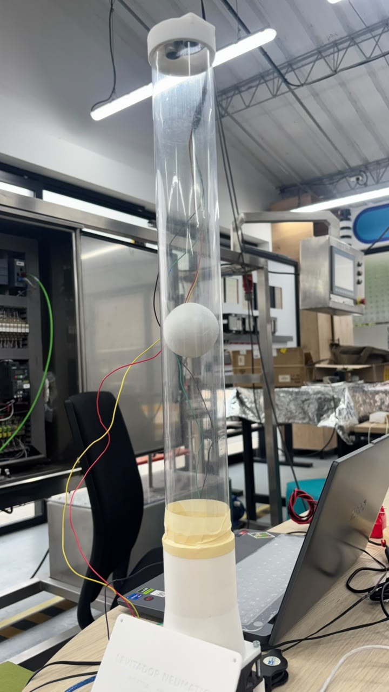
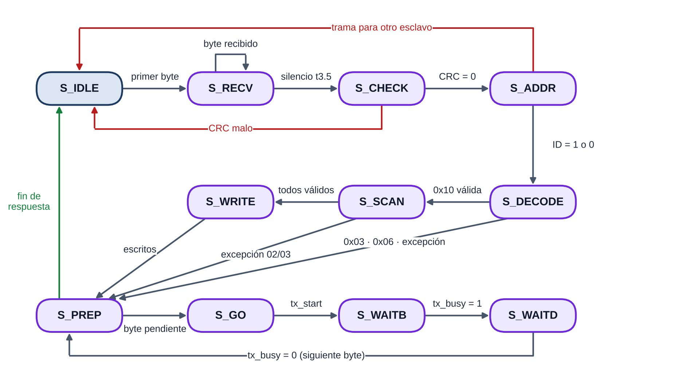
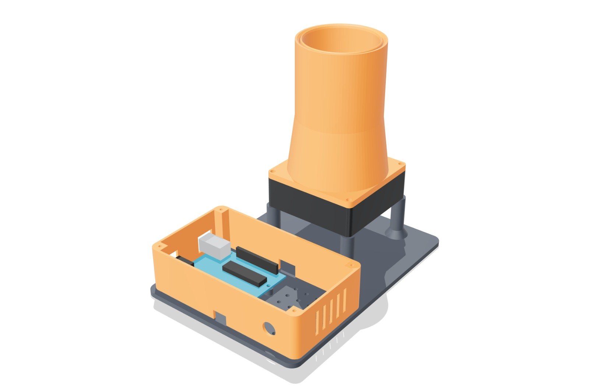

# Sistema de Levitación Neumática con Control PID Digital en VHDL (DE0-Nano)

  

## 📋 Descripción del Proyecto

Este repositorio contiene el desarrollo completo de un sistema de control de posición de lazo cerrado para un levitator neumático, cuyo núcleo de procesamiento implementa un controlador PID digital programado íntegramente en VHDL sobre una tarjeta FPGA Altera Cyclone IV (DE0-Nano). El sistema destaca por una arquitectura heterogénea e industrial que integra la lectura de distancia mediante un sensor ultrasónico gestionado por un Arduino UNO, procesamiento de control y mapeo de registros MODBUS en la FPGA, una pasarela de comunicaciones mediante un módulo ESP32 a través de MODBUS RTU (RS-485), y una interfaz gráfica de supervisión desarrollada en Python para monitorear variables en tiempo real, graficar la respuesta escalón y sintonizar las ganancias de forma remota vía USB o Wi-Fi TCP.

## 🏗️ Arquitectura del Sistema

El sistema implementa una cadena completa de adquisición, procesamiento, comunicación y supervisión industrial mediante el siguiente flujo de bloques:

  

### Función de Cada Bloque

* **Sensor Ultrasónico y Arduino UNO:** Mide la distancia de la pelota dentro del tubo neumático y transmite la lectura cruda mediante comunicación serial UART hacia la FPGA.
* **FPGA DE0-Nano (Cyclone IV):** Núcleo de procesamiento principal. Contiene el decodificador UART, el módulo de control PID digital en VHDL, el banco de registros y el esclavo MODBUS RTU. Calcula la acción de control para regular la velocidad del ventilador.
* **Módulo RS-485 (XY-485):** Adapta los niveles lógicos de comunicación serial de la FPGA a diferenciales robustos para entornos industriales de media distancia.
* **Módulo ESP32:** Actúa como pasarela inteligente (Gateway) recolectando la telemetría del sistema y permitiendo la transmisión de datos tanto por puerto serie (USB) como de forma inalámbrica mediante Wi-Fi (TCP).
* **Interfaz HMI (Python):** Aplicación de supervisión en el PC que permite graficar la respuesta en tiempo real, visualizar variables críticas, registrar datos en formato CSV y sintonizar las ganancias del PID de forma remota.

## 📁 Estructura del Repositorio

El proyecto se encuentra organizado en directorios modulares que separan el código fuente, la lógica digital en VHDL, la interfaz de supervisión y la documentación visual:

* 📁 **[firmware/](firmware/)** — Códigos fuente y programas de desarrollo para microcontroladores.
  * 📄 **[arduino/levitador_v3/levitador_v3.ino](firmware/arduino/levitador_v3/levitador_v3.ino)** — Código para la adquisición de distancia con el sensor ultrasónico y comunicación UART con la FPGA.
  * 📄 **[esp32/](firmware/esp32/)** — Proyecto en PlatformIO para la pasarela de comunicaciones MODBUS RTU y Wi-Fi (TCP).

* 📁 **[fpga/](fpga/)** — Lógica digital, restricciones de pines y diseño hardware en VHDL.
  * 📄 **[quartus/](fpga/quartus/)** — Archivos de configuración y proyecto de Quartus II (`lev_top.qpf`, `.qsf`, `.sdc` y asignación de pines `.tcl`).
  * 📄 **[rtl/](fpga/rtl/)** — Módulos de diseño lógico en VHDL (controlador PID, esclavo MODBUS, banco de registros, UART y decodificadores).

* 📁 **[hmi/](hmi/)** — Aplicación de supervisión, control y adquisición de datos.
  * 📄 **[hmi_levitador.py](hmi/hmi_levitador.py)** — Interfaz gráfica desarrollada en Python para monitoreo y sintonización.
  * 📄 **[requirements.txt](hmi/requirements.txt)** — Dependencias y librerías necesarias de Python.

* 📁 **[images/](images/)** — Archivos multimedia, fotografías del montaje de laboratorio y esquemas visuales.

* 📄 **[physical connections.html](physical%20connections.html)** — Guía detallada de conexiones físicas del sistema.
* 📄 **[.gitignore](.gitignore)** — Archivos y carpetas ignorados por el control de versiones de Git.

## 🔌 Conexiones del Sistema

### 1. Pines del Conector JP1 de la FPGA (DE0-Nano)
* `mb_tx`: Transmisión serial hacia el bus MODBUS (RS-485).
* `mb_rx`: Recepción serial desde el bus MODBUS (RS-485).
* `mb_de`: Señal de habilitación de driver (*Data Enable*) para el bus RS-485.
* `ard_tx`: Recepción de datos provenientes del Arduino.
* `ard_rx`: Transmisión de datos hacia el Arduino.
* `5V` y `GND`: Alimentación general compartida en el bus.

### 2. Conexiones del Arduino UNO
* **Sensor Ultrasónico:** 
  * `TRIG`: Pin digital 2
  * `ECHO`: Pin digital 3 (con divisor de voltaje de $1\,\text{k}\Omega$ / $2\,\text{k}\Omega$ hacia la FPGA para protección de niveles lógicos de $5\,\text{V}$ a $3.3\,\text{V}$).
* **Control del Ventilador / Actuador:**
  * `PWM`: Pin digital 9 (salida hacia el módulo MOSFET).
* **Comunicación Serial con la FPGA:**
  * `RX`: Pin digital 10
  * `TX`: Pin digital 11

### 3. Conexiones del Módulo ESP32 y RS-485 (XY-485)
* `GPIO17 (TX2)` del ESP32 $\rightarrow$ `RXD` del módulo RS-485.
* `GPIO16 (RX2)` del ESP32 $\leftarrow$ `TXD` del módulo RS-485.
* Conexión diferencial: Borne `A` con `A`, borne `B` con `B`, y `GND` común entre los dispositivos.

### 4. Significado de los LEDs de la FPGA (LED 0 a 5)
* **LED 0:** Indica actividad o pulso de recepción de datos UART desde el Arduino.
* **LED 1:** Muestra el estado de transmisión de la trama serial hacia el bus.
* **LED 2:** Señaliza la recepción correcta de una trama válida mediante el esclavo MODBUS.
* **LED 3:** Activo cuando el lazo de control PID se encuentra habilitado (`PID_EN = 1`).
* **LED 4:** Indicador de desbordamiento o error en el cálculo del PID.
* **LED 5:** Estado general del sistema / *Heartbeat* (parpadeo de ejecución normal del reloj principal).

## 💻 Requisitos de Software

Para el desarrollo, compilación, programación e interfaz del sistema, es necesario contar con las siguientes herramientas de software instaladas en el equipo:

* 🎛️ **Quartus II (Versión 13.1) y Quartus Prime Programmer:** Entorno de diseño para sistemas FPGA de Intel/Altera. Permite la síntesis, implementación, asignación de pines y carga del archivo de configuración bitstream (`.sof`) en la tarjeta DE0-Nano.
* 🤖 **Arduino IDE:** Entorno de desarrollo para programar el microcontrolador Arduino UNO y gestionar la adquisición de distancia con el sensor ultrasónico.
* ⚡ **Visual Studio Code con PlatformIO:** Entorno de desarrollo avanzado utilizado para compilar, configurar y cargar el firmware del módulo ESP32 (proyecto ubicado en la carpeta `firmware/esp32/`), empleando la librería ModbusMaster para la comunicación serial y pasarela MODBUS.
* 🐍 **Python (Versiones 3.10 a 3.12):** Intérprete y entorno de ejecución requerido para correr la interfaz HMI de supervisión y control (`hmi_levitator.py`), junto con la instalación previa de las dependencias descritas en el archivo `requirements.txt`.

## 🚀 Puesta en marcha de la FPGA

Para configurar y programar la tarjeta FPGA DE0-Nano con el sistema de control digital, sigue los siguientes pasos en Quartus II:

1. **Apertura del proyecto:** Abre el software Quartus II 13.1 y carga el archivo de proyecto principal ubicado en la ruta `fpga/quartus/lev_top.qpf`.
2. **Asignación de pines:** Ejecuta el script de restricciones físicas para configurar correctamente las entradas y salidas de la tarjeta abriendo la consola Tcl (`Tools > Tcl Scripts`) y ejecutando el archivo `pines_de0nano.tcl`.
3. **Compilación del diseño:** Inicia el proceso de síntesis, colocación y enrutamiento (*Processing > Start Compilation*) para generar los archivos binarios de configuración.
4. **Programación del dispositivo:** Conecta la tarjeta DE0-Nano por USB, abre *Quartus Prime Programmer*, selecciona el puerto de hardware correspondiente, verifica que el archivo de configuración bitstream `lev_top.sof` esté seleccionado y presiona **Start** para programar la FPGA.

  

### Valores Iniciales de Arranque en la FPGA
Al momento de inicializar y arrancar el sistema digital, los registros internos toman los siguientes valores por defecto:
* **SP (Setpoint):** Altura de referencia inicial para la posición de la pelota dentro del tubo.
* **Ganancias PID:** $K_p$, $K_i$ y $K_d$ configuradas con sus valores predeterminados de sintonización.
* **BIAS:** Nivel base o compensación de polarización para el actuador.
* **Lazo Habilitado:** Estado inicial del lazo de control (`PID_EN`).

## 📥 Carga del Arduino

Para programar el microcontrolador encargado de la adquisición de distancia y la comunicación serial con la FPGA, sigue estos pasos:

1. **Apertura del archivo:** Abre el software *Arduino IDE* y carga el archivo de código fuente principal ubicado en la ruta `firmware/arduino/levitator_v3/levitator_v3.ino`.
2. **Selección de placa y puerto:** Conecta el Arduino UNO al equipo mediante un cable USB, ve al menú `Herramientas > Placa` (selecciona *Arduino Uno*) y en `Herramientas > Puerto` selecciona el puerto COM correspondiente.
3. **Compilación y carga:** Haz clic en el botón de **Cargar** (flecha hacia la derecha) para compilar el sketch e instalar el firmware en la placa.
4. **Verificación en la consola serie:** Abre el *Monitor Serie* del Arduino IDE configurado a la velocidad en baudios correspondiente para verificar las lecturas en tiempo real del sensor ultrasónico y comprobar que el comando de lectura responde correctamente.

## 🌉 Puente ESP32

Para configurar, compilar y verificar el funcionamiento de la pasarela de comunicaciones basada en el ESP32, realiza los siguientes pasos:

1. **Apertura del proyecto en PlatformIO:** Abre *Visual Studio Code* y abre la carpeta del proyecto ubicada en `firmware/esp32/`.
2. **Configuración de parámetros:** Modifica el archivo `src/main.cpp` configurando correctamente las credenciales de red y los parámetros del sistema:
   * `WIFI_SSID`: Nombre de tu red Wi-Fi.
   * `WIFI_PASS`: Contraseña de la red Wi-Fi.
   * `USE_WIFI`: Habilitar o deshabilitar la comunicación inalámbrica (true/false).
   * `H0_CM`: Parámetro inicial de altura de referencia base.
3. **Compilación y carga:** Conecta el módulo ESP32 al computador, haz clic en el botón de **Build** (compilar) y posteriormente en **Upload** (cargar) en la barra de herramientas de PlatformIO.
4. **Verificación en el monitor serie:** Abre el monitor serie a una velocidad de **115200 baudios** para verificar que el dispositivo se conecta correctamente a la red y transmite los datos del bus MODBUS RTU. 
   > ⚠️ **Nota importante:** Es obligatorio **cerrar el monitor serie** de PlatformIO antes de abrir la interfaz HMI en Python para evitar conflictos de acceso al puerto COM.

## 📏 Calibración de la Altura (`H0_CM`)

La calibración de la altura base es un procedimiento fundamental para relacionar la lectura en centímetros de la pelota con respecto al fondo del tubo neumático:

1. **Fórmula de Relación:** 
   El cálculo de la posición instantánea de la pelota dentro de la columna de aire se obtiene mediante la siguiente relación:
   > `Altura (cm) = H0_CM - Distancia_Medida`

2. **Procedimiento de Medición de `H0_CM`:**
   * Coloca la pelota completamente apoyada en el fondo del tubo neumático (posición de referencia cero).
   * Toma la lectura de distancia que entrega el sensor ultrasónico en ese punto exacto.
   * Asigna ese valor medido a la variable global `H0_CM` en el firmware para calibrar el cero del sistema y asegurar que las lecturas de altura en la interfaz HMI coincidan perfectamente con la realidad física.

  

## 🖥️ Interfaz HMI (Supervisión y Control)

La interfaz gráfica en Python permite monitorear el comportamiento del sistema en tiempo real, visualizar gráficas de respuesta y sintonizar los parámetros del controlador PID:

1. **Requisitos previos:** Asegúrate de instalar las librerías necesarias ejecutando el comando `pip install -r requirements.txt` en tu terminal dentro de la carpeta [hmi/](hmi/).
2. **Ejecución de la Interfaz:** Inicia la aplicación ejecutando el script principal:
   > `python hmi_levitator.py`
3. **Funcionalidades Principales:**
   * **Monitoreo en tiempo real:** Visualización gráfica de la posición actual de la pelota frente al valor deseado (*Setpoint*).
   * **Control PID:** Ajuste dinámico de las ganancias $K_p$, $K_i$ y $K_d$, así como la activación o desactivación del lazo de control.
   * **Comunicación Modbus:** Conexión robusta a través del puerto serial o mediante red Wi-Fi con el puente ESP32.

  

## 📡 Protocolos de Comunicación

El sistema emplea una arquitectura de comunicaciones robusta dividida en dos niveles principales para garantizar la transferencia segura y en tiempo real de las variables críticas:

1. **Comunicación Serial UART (Nivel Local - FPGA / Arduino):**
   * **Velocidad de transmisión:** Configurada a alta velocidad en baudios para minimizar el retardo de propagación.
   * **Propósito:** Transmitir continuamente la lectura en crudo de la distancia capturada por el sensor ultrasónico desde el Arduino UNO hacia el receptor serial interno de la FPGA.
   * **Trama UART Arduino ↔ FPGA:** Paquete de datos estructurado que transporta la distancia medida y los estados de sincronización locales entre ambos dispositivos para asegurar la actualización del lazo cerrado.

2. **Bus Industrial MODBUS RTU sobre RS-485 (Nivel de Supervisión):**
   * **Topología:** Conexión diferencial multipunto tolerante al ruido electromagnético de entorno industrial.
   * **Esclavo MODBUS:** La FPGA implementa un núcleo esclavo MODBUS RTU que gestiona el **Mapa de registros MODBUS RTU (`mb_regmap.vhd`) y escala de cada registro**, permitiendo escalar correctamente variables de posición en centímetros, ganancias y variables de control.
   * **Pasarela ESP32 Gateway:** Permite actuar como puente transparente traduciendo las tramas MODBUS RTU hacia una red local inalámbrica (Wi-Fi TCP) o mediante puerto serie USB. 
   * **Trama de telemetría del ESP32:** Transmite paquetes estructurados con formato `*...#` que constan de **10 campos**, incluyendo el estado general (`STATUS`), variables de proceso y respuestas de control tipo `*ACK,...#` para confirmar la recepción exitosa de comandos desde la HMI.

  

## ⚙️ Controlador PID Digital (VHDL)

El núcleo del sistema de control en lazo cerrado está implementado íntegramente en lógica digital sobre la FPGA, ejecutando el algoritmo PID discreto:

1. **Estructura del Algoritmo:**
   * **Error instantáneo:** `e[k] = Setpoint[k] - Variable_Proceso[k]`
   * **Acción Proporcional ($P$):** Respuesta directa y proporcional a la magnitud del error actual.
   * **Acción Integral ($I$):** Acumulación histórica del error para eliminar el error en estado estacionario.
   * **Acción Derivativa ($D$):** Sensibilidad ante la tasa de cambio del error para amortiguar oscilaciones y mejorar la estabilidad transitoria.

2. **Implementación en Hardware (`pid_controller.vhd`):**
   * Desarrollado en aritmética de punto fijo para optimizar el uso de recursos lógicos dentro de la FPGA Cyclone IV.
   * Cuenta con protección contra saturación (*Anti-Windup*) en el término integral para evitar sobreimpulsos severos en los cambios de referencia.
   * Salida configurada para modular el ciclo de trabajo (*Duty Cycle*) de la señal PWM que acciona el ventilador del sistema de levitación.

  

## 🔧 Solución de Problemas (Troubleshooting)

Si encuentras anomalías durante la puesta en marcha, integración o pruebas del sistema de levitación neumática, consulta la siguiente guía de diagnóstico rápido:

| Síntoma o Problema | Causa Probable | Solución Recomendada |
| :--- | :--- | :--- |
| **El sensor ultrasónico no mide la distancia correctamente.** | Mala conexión de pines o falta de protección de niveles lógicos en el pin ECHO del Arduino. | Verifica el divisor de resistencia ($1\text{ k}\Omega / 2\text{ k}\Omega$) en el pin ECHO para asegurar los $3.3\text{ V}$ compatibles con la FPGA y revisa los pines digitales 2 y 3. |
| **La FPGA no responde al Bus MODBUS.** | Polaridad invertida en el módulo RS-485 (XY-485) o velocidad en baudios incorrecta. | Comprueba que los bornes **A con A** y **B con B** estén bien conectados, comparte la tierra física (GND) y verifica que la velocidad de transmisión coincida en todos los dispositivos. |
| **Conflicto de puertos al abrir la HMI en Python.** | El monitor serie de Arduino IDE o PlatformIO se encuentra abierto ocupando el puerto COM. | Cierra obligatoriamente cualquier monitor serial activo en VS Code o Arduino IDE antes de ejecutar el script `hmi_levitator.py`. |
| **El ventilador no reacciona al control PID.** | El módulo MOSFET (IRF520) no está recibiendo la señal PWM adecuada o carece de alimentación de potencia. | Revisa la conexión del pin PWM, comprueba la alimentación externa de 12V del ventilador y verifica que el LED de habilitación del lazo (`PID_EN = 1`) esté activo en la FPGA. |
| **El ESP32 no transmite telemetría vía Wi-Fi.** | Credenciales de red erróneas o parámetro `USE_WIFI` desactivado en el código fuente. | Abre el archivo `src/main.cpp` en PlatformIO, actualiza correctamente `WIFI_SSID` y `WIFI_PASS`, y asegúrate de configurar `USE_WIFI = true`. |

  

## 📈 Resultados y Pruebas del Sistema

Durante las pruebas experimentales del sistema de levitación neumática en el laboratorio, se evaluó el desempeño global del lazo de control PID digital implementado en la FPGA bajo diferentes escenarios de operación y perturbación:

1. **Respuesta ante Escalón (Setpoint Tracking):** 
   * El sistema demostró una respuesta rápida y dinámica al modificar la referencia de altura de la pelota dentro de la columna de aire.
   * Con una sintonización adecuada de las ganancias $K_p$, $K_i$ y $K_d$, se logró minimizar el sobreimpulso (*overshoot*) y estabilizar la posición de la pelota en el valor deseado sin oscilaciones sostenidas.

2. **Rechazo a Perturbaciones:**
   * Ante perturbaciones externas (como variaciones leves en el flujo de aire o interferencias mecánicas en el tubo), el lazo cerrado ejecutado por la FPGA compensa automáticamente la acción de control variando la señal PWM del ventilador para retornar la pelota a la altura establecida de forma eficiente.

3. **Adquisición y Registro de Telemetría:**
   * La interfaz HMI en Python permitió exportar los registros de telemetría a archivos CSV para su posterior análisis de desempeño en herramientas de procesamiento numérico.

  

## 👥 Autores y Créditos

Este proyecto fue desarrollado como parte de la **Electiva Profesional II – Diseño Digital Avanzado con VHDL** para la implementación de sistemas embebidos, control digital y automatización industrial:

* **Integrantes del Equipo de Desarrollo:**
  * David Felipe Manzano Aldana
  * Liceth Tatiana Bolaños Cardona
  * David Santiago Vallejo Rodríguez
  * Santiago Albarracín Galvis
  * Samuel David Guevara Quiñones
  * Daniela Montoya Ospina
  * Luis Alejandro Cifuentes Henao
  * Juan Esteban Viveros Trujillo
  * Ana Sofía Valderrama Varela

* **Programas Académicos:** Ingeniería Electrónica e Ingeniería Biomédica
* **Docente:** Sergio Andrés Arenas Hoyos
* **Institución:** Unidad Central del Valle del Cauca (UCEVA) — Tuluá, Valle del Cauca, Colombia
