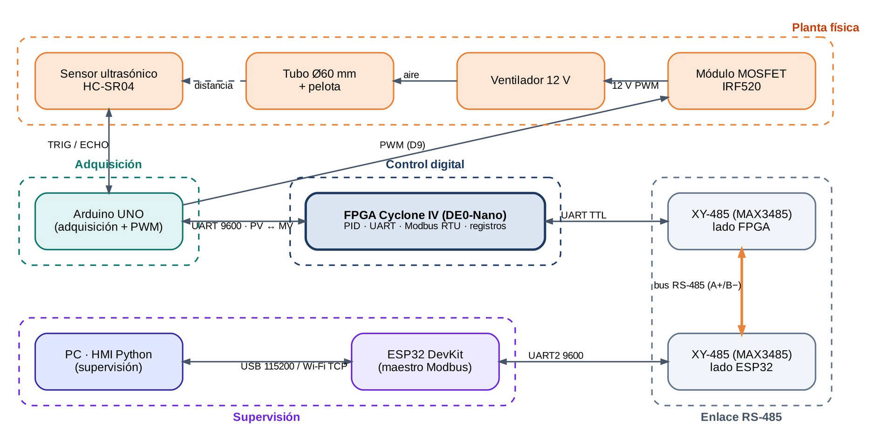
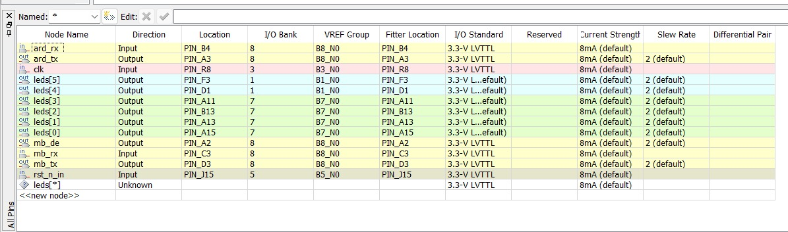
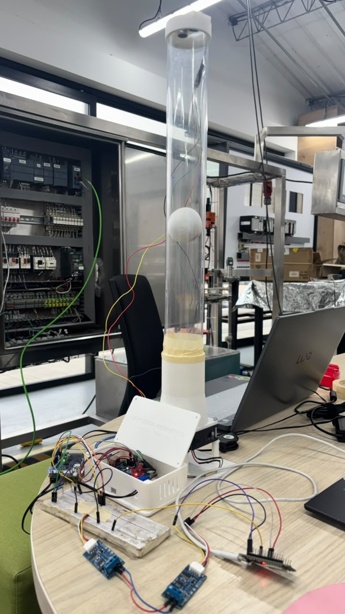
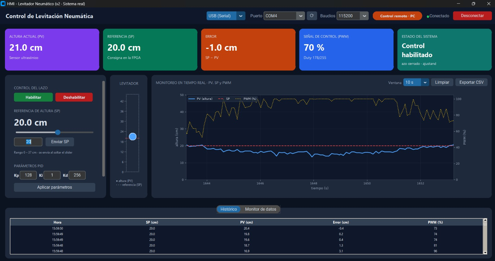
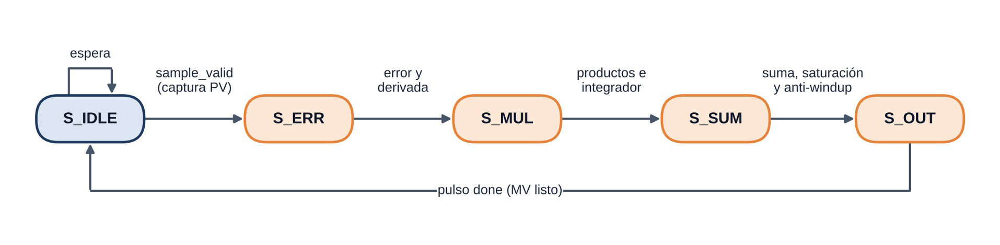
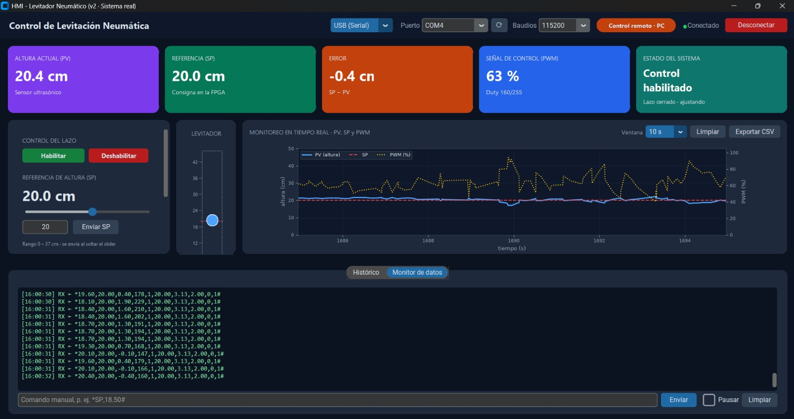

# Levitador neumático con control PID en FPGA

<p align="center">
  
</p>

## 📋 Descripción del proyecto

Levitación neumática de una pelota de icopor dentro de un tubo, con un controlador PID digital escrito en VHDL sobre una DE0-Nano (Cyclone IV). Un Arduino UNO mide la altura y mueve el ventilador, un ESP32 actúa como maestro MODBUS RTU sobre RS-485 y una interfaz en Python permite supervisar y sintonizar el lazo.

## 🏗️ Arquitectura del sistema

El sistema forma una cadena completa de adquisición, control, comunicación y supervisión:

<p align="center">
  
</p>

### Función de cada bloque

* **Sensor ultrasónico y Arduino UNO:** mide cada 50 ms la distancia del sensor a la pelota y la envía por UART a la FPGA. Recibe de vuelta la acción de control y genera el PWM del ventilador.
* **FPGA DE0-Nano (Cyclone IV):** núcleo de control. Contiene los UART, el enlace con el Arduino, el PID digital, el banco de registros y el esclavo MODBUS RTU.
* **Módulos RS-485 (XY-485):** convierten la UART de la FPGA y del ESP32 en un bus diferencial RS-485.
* **ESP32:** maestro MODBUS RTU. Lee los registros de la FPGA cada 100 ms y los reenvía a la HMI por USB o por Wi-Fi (TCP), y escribe en la FPGA los cambios que pide la HMI.
* **Interfaz HMI (Python):** aplicación de supervisión en el PC para graficar la respuesta en tiempo real, cambiar la referencia y las ganancias, habilitar el lazo y exportar los datos a CSV.

## 📁 Estructura del repositorio

* **[firmware/](firmware/)**: firmware de los microcontroladores.
  * **[arduino/levitador_v3/levitador_v3.ino](firmware/arduino/levitador_v3/levitador_v3.ino)**: adquisición con el sensor ultrasónico, PWM del ventilador y enlace UART con la FPGA.
  * **[esp32/](firmware/esp32/)**: proyecto PlatformIO del puente MODBUS RTU con USB y Wi-Fi (TCP).
* **[fpga/](fpga/)**: diseño digital.
  * **[quartus/](fpga/quartus/)**: proyecto de Quartus (`lev_top.qpf`, `lev_top.qsf` con la asignación de pines, `lev_top.sdc` con la restricción de reloj).
  * **[rtl/](fpga/rtl/)**: módulos VHDL (PID, esclavo MODBUS, mapa de registros, banco de registros, UART y enlace con el Arduino).
* **[hmi/](hmi/)**: interfaz de supervisión.
  * **[hmi_levitador.py](hmi/hmi_levitador.py)**: interfaz gráfica en Python.
  * **[requirements.txt](hmi/requirements.txt)**: dependencias de Python.
* **[images/](images/)**: fotografías del montaje y diagramas.
* **[physical connections.html](physical%20connections.html)**: guía interactiva de conexiones, cable por cable.

## 🔌 Conexiones del sistema

La guía completa está en [physical connections.html](physical%20connections.html).

### 1. Conector JP1 de la FPGA (DE0-Nano)

| Pin JP1 | Pin FPGA | Señal | Conexión |
| :---: | :---: | :--- | :--- |
| 2 | D3 | `mb_tx` | TXD del XY-485 (lado FPGA) |
| 4 | C3 | `mb_rx` | RXD del XY-485 (lado FPGA) |
| 5 | A2 | `mb_de` | Libre (los XY-485 controlan la dirección solos) |
| 6 | A3 | `ard_tx` | D10 del Arduino (RX) |
| 8 | B4 | `ard_rx` | D11 del Arduino (TX), a través del divisor 1 kΩ / 2 kΩ |
| 11 | — | 5 V | VCC del XY-485 (lado FPGA) |
| 12 y 30 | — | GND | GND del XY-485 y del Arduino |

### 2. Arduino UNO

* **Sensor ultrasónico HC-SR04:** `TRIG` en D2 y `ECHO` en D3. VCC a 5 V del Arduino.
* **Ventilador:** D9 (PWM) a la entrada `SIG` del módulo MOSFET IRF520. El ventilador y la fuente de 12 V van a los bornes de potencia del módulo.
* **Enlace con la FPGA (9600 baudios):**
  * D10 (RX) ← `ard_tx` (JP1 pin 6).
  * D11 (TX) → resistencia de 1 kΩ → `ard_rx` (JP1 pin 8), con 2 kΩ de ese punto a GND. El divisor baja los 5 V del Arduino a unos 3.3 V que tolera la FPGA.

### 3. ESP32 y RS-485 (XY-485)

* `GPIO17 (TX2)` del ESP32 → `TXD` del XY-485 (lado ESP32).
* `RXD` del XY-485 → `GPIO16 (RX2)` del ESP32.
* `VIN (5 V)` del ESP32 → `VCC` del XY-485.
* Bus RS-485: borne `A` con `A` y borne `B` con `B` entre los dos módulos.
* GND común entre FPGA, Arduino, ESP32 y la fuente de 12 V.

### 4. LEDs de la FPGA (LED 0 a 5)

| LED | Significado |
| :---: | :--- |
| 0 | Lazo PID habilitado |
| 1 | El sensor no recibió eco (lectura fuera de rango) |
| 2 | Timeout: el Arduino dejó de enviar mediciones (el ventilador se apaga) |
| 3 | Parpadea con cada muestra recibida del Arduino |
| 4 | Cambia con cada trama MODBUS válida |
| 5 | Se enciende 0.5 s tras una trama MODBUS con CRC malo o una excepción |

## 💻 Requisitos de software

* **Quartus II 13.1 o Quartus Prime Lite** con soporte para Cyclone IV E. Incluye el Programmer y el driver USB-Blaster.
* **Arduino IDE** para el Arduino UNO.
* **Visual Studio Code con PlatformIO IDE** para el ESP32. La primera compilación descarga la plataforma `espressif32` y la librería ModbusMaster.
* **Python 3.10 a 3.12** para la HMI (`hmi_levitador.py`), con las dependencias de `requirements.txt`.
* **Driver CP210x o CH340**, según el chip USB del ESP32.

## 🚀 Puesta en marcha de la FPGA

1. **Abrir el proyecto:** en Quartus, *File > Open Project* y elegir `fpga/quartus/lev_top.qpf`. La asignación de pines y el reloj de 50 MHz ya vienen en `lev_top.qsf` y `lev_top.sdc`.
2. **Compilar:** *Processing > Start Compilation* (Ctrl + L). Se genera `fpga/quartus/output_files/lev_top.sof`.
3. **Programar:** conectar la DE0-Nano por USB y abrir *Tools > Programmer*. En *Hardware Setup* elegir **USB-Blaster**, dejar el modo **JTAG**, verificar que esté `output_files/lev_top.sof` con *Program/Configure* marcado y pulsar **Start**.

> **Importante:** el `.sof` se carga en memoria volátil. Si la DE0-Nano se desconecta, hay que volver a programarla.

<p align="center">
  
</p>

### Valores iniciales de la FPGA

Al programarse, la FPGA arranca con estos valores (definidos en `lev_top.vhd`):

| Parámetro | Valor en la FPGA | Equivalente en la HMI |
| :--- | :--- | :--- |
| SP (referencia) | 230 mm de distancia sensor-pelota | ≈ 23 cm de altura con `H0_CM = 46.0` |
| Kp | 8192 (2.0 PWM/mm) | 20.00 PWM/cm |
| Ki | 64 (0.0156 PWM/(mm·muestra)) | 3.13 PWM/(cm·s) |
| Kd | 16384 (4.0 PWM/(mm/muestra)) | 2.00 PWM·s/cm |
| BIAS | 160 (PWM base de sustentación) | — |
| ENABLE | 1 (lazo habilitado) | — |

## 📥 Carga del Arduino

1. **Abrir el sketch:** en el Arduino IDE, abrir `firmware/arduino/levitador_v3/levitador_v3.ino`.
2. **Elegir placa y puerto:** *Herramientas > Placa > Arduino Uno* y, en *Herramientas > Puerto*, el COM del Arduino.
3. **Compilar y cargar:** pulsar **Subir** (flecha a la derecha).
4. **Verificar:** abrir el *Monitor Serie* a **115200 baudios** con fin de línea **Nueva línea**. Debe aparecer una línea por medición con el formato `PV: <mm> mm | SP: <mm> mm | MV: <pwm>`.

Desde el Monitor Serie se pueden leer y escribir los registros de la FPGA sin la HMI:

| Comando | Acción |
| :--- | :--- |
| `leer` | Muestra todos los registros de la FPGA |
| `on` / `off` | Habilita o detiene el lazo |
| `sp <mm>` | Referencia como distancia sensor-pelota |
| `kp <x>`, `ki <x>`, `kd <x>` | Ganancias por muestra (PWM/mm) |
| `bias <0-255>` | PWM base |
| `cal <0-255>` | Modo manual: ganancias en cero y PWM fijo |
| `plot` | Salida para el Serial Plotter |
| `ayuda` | Lista de comandos |

## 🌉 Puente ESP32

1. **Abrir el proyecto:** en VS Code con PlatformIO, *Open Project* y elegir la carpeta `firmware/esp32/`.
2. **Configurar `src/main.cpp`:**
   * `WIFI_SSID` y `WIFI_PASS`: nombre y clave de la red Wi-Fi.
   * `USE_WIFI`: `1` para habilitar el servidor TCP (puerto 8888), `0` para usar solo USB.
   * `H0_CM`: distancia, en cm, del sensor a la pelota en reposo en el fondo del tubo (ver la sección de calibración).
3. **Compilar y cargar:** conectar el ESP32 y pulsar **Build** y luego **Upload** en la barra de PlatformIO. Si se queda en *Connecting…*, mantener pulsado el botón **BOOT**.
4. **Verificar:** abrir el monitor serie a **115200 baudios**. Con `USE_WIFI 1` muestra la IP asignada (si la red no responde en 10 s, sigue funcionando solo por USB) y luego una trama `*...#` cada 100 ms.

> ⚠️ **Importante:** cierra el monitor serie de PlatformIO antes de abrir la HMI. El puerto COM solo puede usarlo un programa a la vez.

## 📏 Calibración de la altura (`H0_CM`)

La FPGA trabaja con distancias sensor-pelota, y el ESP32 las convierte en alturas para la HMI con:

```
Altura (cm) = H0_CM − Distancia medida (cm)
```

Para calibrar `H0_CM`:

1. Detener el lazo (`off` en el Monitor Serie del Arduino) y esperar a que la pelota quede apoyada en el fondo del tubo.
2. Escribir `leer` en el Monitor Serie del Arduino y anotar el valor de PV, que está en milímetros.
3. Pasar ese valor a centímetros y ponerlo en `#define H0_CM` de `src/main.cpp` (por ejemplo, 453 mm → `45.3f`).
4. Volver a compilar y cargar el ESP32.

<p align="center">
  
</p>

## 🖥️ Interfaz HMI (supervisión y control)

1. **Instalar dependencias** (una sola vez), desde la carpeta [hmi/](hmi/):
   ```bash
   python -m venv .venv
   .venv\Scripts\activate        # Windows (en Linux/macOS: source .venv/bin/activate)
   pip install -r requirements.txt
   ```
2. **Ejecutar la interfaz:**
   ```bash
   python hmi_levitador.py
   ```
3. **Conectarse:** en la barra superior elegir el modo y pulsar **Conectar**.
   * **USB (Serial):** puerto COM del ESP32, a 115200 baudios.
   * **Wi-Fi (TCP):** IP del ESP32 (puerto 8888). El PC y el ESP32 deben estar en la misma red.
4. **Funciones principales:**
   * **Monitoreo en tiempo real:** gráficas de altura (PV), referencia (SP) y PWM, con tarjetas de PV, SP, error y PWM.
   * **Control:** envío de la referencia (**Enviar SP**), ajuste de $K_p$, $K_i$ y $K_d$ (**Aplicar parámetros**) y botones **Habilitar** / **Deshabilitar** del lazo.
   * **Registro:** histórico de datos y botón **Exportar CSV**.

<p align="center">
  
</p>

## 📡 Protocolos de comunicación

1. **UART Arduino ↔ FPGA (9600 baudios, 8N1):**
   * Cada 50 ms el Arduino envía la medición `AA PV_H PV_L CHK` (PV en mm; `FFFF` = sin eco) y la FPGA responde `55 MV STATUS CHK` con el PWM que debe aplicar.
   * Para leer o escribir registros desde la consola se usan las tramas `A6` (leer) y `A5` (escribir); la FPGA responde con `5A`.
   * Todas las tramas llevan un checksum XOR.

2. **MODBUS RTU sobre RS-485 (9600 baudios, 8N1), ESP32 ↔ FPGA:**
   * **Esclavo MODBUS (FPGA, dirección 1):** atiende las funciones 0x03, 0x06 y 0x10 con verificación CRC-16. El mapa de registros (`mb_regmap.vhd`) expone 10 holding registers (SP, KP, KI, KD, EN, PV, ERR, PWM, STATUS y BIAS) en unidades de cm × 100 y ganancias × 100, y los convierte a las unidades internas del PID.
   * **Maestro MODBUS (ESP32):** lee los registros 0 a 8 cada 100 ms y escribe la referencia, las ganancias y la habilitación cuando la HMI lo pide.

3. **Enlace ESP32 ↔ HMI (USB a 115200 baudios o TCP puerto 8888):** protocolo de texto. El ESP32 envía la telemetría `*PV,SP,ERR,PWM,EN,KP,KI,KD,MB,ST#` (10 campos) y confirma cada orden con `*ACK,...#`. La HMI envía comandos como `*SP,20.00#`, `*PID,20.00,3.13,2.00#` y `*EN,1#`.

<p align="center">
  
</p>

## ⚙️ Controlador PID digital (VHDL)

El lazo de control se ejecuta en la FPGA (`pid_ctrl.vhd`) cada vez que llega una medición del Arduino, es decir, con un periodo de muestreo de 50 ms.

1. **Algoritmo:**
   * **Error:** `e[k] = PV[k] − SP[k]`, en distancias sensor-pelota. Un error positivo indica que la pelota está por debajo de la referencia y hay que aumentar el PWM.
   * **Acción proporcional:** proporcional al error actual.
   * **Acción integral:** acumula el error para eliminar el error en estado estacionario.
   * **Acción derivativa:** se calcula sobre la medición (no sobre el error), con un filtro de primer orden, para evitar picos en los cambios de referencia y amortiguar oscilaciones.
   * **Salida:** `MV = BIAS + (P + I + D) / 4096`, saturada entre 30 y 255 mientras el lazo está activo. Vale 0 si el lazo está detenido, el sensor falla o el Arduino deja de comunicar.

2. **Implementación en hardware:**
   * Aritmética de punto fijo: las ganancias se guardan multiplicadas por 4096.
   * Máquina de estados que calcula el error, las multiplicaciones, la suma y la salida en ciclos sucesivos.
   * Anti-windup por *clamping*: el integrador deja de acumular cuando la salida está saturada y el error la empujaría más allá del límite.
   * Watchdog: si pasan 250 ms sin mediciones del Arduino, el PWM pasa a 0 y se enciende el LED 2.

<p align="center">
  
</p>

## 🔧 Solución de problemas

| Síntoma | Causa probable | Solución |
| :--- | :--- | :--- |
| **El Arduino muestra `Sin respuesta valida de la FPGA`.** | FPGA sin programar, D10/D11 invertidos o falta el divisor o el GND común. | Programar la FPGA y revisar D10 → JP1 pin 6, D11 → divisor 1 kΩ / 2 kΩ → JP1 pin 8, y GND común. |
| **El sensor no mide bien (LED 1 encendido).** | `TRIG`/`ECHO` mal conectados o sensor desalineado. | Revisar D2 y D3, y que el sensor apunte recto por el centro del tubo. |
| **La FPGA no responde al bus MODBUS.** | Bornes A/B invertidos, TXD/RXD mal conectados o sin GND común. | Comprobar **A con A** y **B con B**, GPIO17 → TXD y RXD → GPIO16 en el lado ESP32, y GND común. El LED 4 debe parpadear y el LED 5 permanecer apagado. |
| **La HMI no abre el puerto COM.** | El monitor serie de Arduino IDE o PlatformIO ocupa el puerto. | Cerrar cualquier monitor serie antes de ejecutar `hmi_levitador.py`. |
| **El ventilador no reacciona al PID.** | El IRF520 no recibe el PWM, falta la alimentación de 12 V o el lazo está deshabilitado. | Revisar D9 → `SIG`, la fuente de 12 V y que el LED 0 esté encendido (si no, pulsar **Habilitar** en la HMI o escribir `on`). |
| **El ESP32 no se conecta por Wi-Fi.** | Credenciales incorrectas o `USE_WIFI` en 0. | Corregir `WIFI_SSID` y `WIFI_PASS` en `src/main.cpp`, dejar `#define USE_WIFI 1` y volver a cargar. Mientras tanto se puede usar USB. |
| **La altura en la HMI no coincide con la real.** | `H0_CM` sin calibrar. | Seguir la sección de calibración de la altura. |

<p align="center">
  
</p>

## 📈 Resultados y pruebas del sistema

Durante las pruebas en el laboratorio se evaluó el desempeño del lazo PID implementado en la FPGA:

1. **Seguimiento de la referencia:** al cambiar la altura deseada, la pelota alcanza la nueva referencia y se estabiliza sin oscilaciones sostenidas con las ganancias finales (Kp = 20.00, Ki = 3.13 y Kd = 2.00 en la HMI).
2. **Rechazo a perturbaciones:** ante perturbaciones externas en el flujo de aire, la FPGA ajusta el PWM del ventilador y devuelve la pelota a la altura establecida.
3. **Registro de datos:** la HMI permitió exportar los datos de cada prueba a archivos CSV para su análisis posterior.

<p align="center">
  
</p>

## 👥 Autores y créditos

Proyecto desarrollado en la **Electiva Profesional II – Diseño Digital Avanzado con VHDL**.

* **Integrantes:**
  * David Felipe Manzano Aldana
  * Liceth Tatiana Bolaños Cardona
  * David Santiago Vallejo Rodríguez
  * Santiago Albarracín Galvis
  * Samuel David Guevara Quiñones
  * Daniela Montoya Ospina
  * Luis Alejandro Cifuentes Henao
  * Juan Esteban Viveros Trujillo
  * Ana Sofía Valderrama Varela
* **Programas académicos:** Ingeniería Electrónica e Ingeniería Biomédica
* **Docente:** Sergio Andrés Arenas Hoyos
* **Institución:** Unidad Central del Valle del Cauca (UCEVA), Tuluá, Valle del Cauca, Colombia
